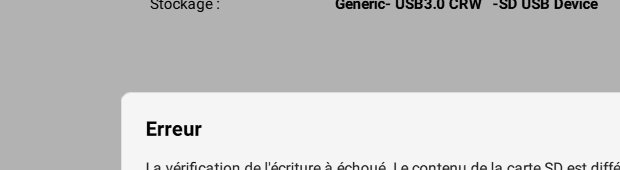

# Raspberry Pi — installation Linux sur carte microSD (Fatlab)

**Date :** 6 novembre 2026  
**Statut :** préparation en cours ; écriture et démarrage non encore confirmés.  
**Contexte :** atelier Fatlab, installation de Linux sur Raspberry Pi avec lecteur de carte SD USB, après une première tentative avec une clé USB.

## Matériel et outil observés
- Raspberry Pi (modèle exact non encore identifié).
- Carte microSD dans un lecteur USB reconnu sous Windows comme `Generic- USB3.0 CRW -SD USB Device`, capacité affichée **37,3 Go**, lecteur **E:\\**.
- **Raspberry Pi Imager v2.0.12** sous Windows.

> Attention : l'écriture d'une image OS efface le contenu du support sélectionné. Vérifier que E: est bien la carte microSD avant de lancer l'écriture.

## Étapes constatées (captures du 6 novembre)
1. Ouverture de Raspberry Pi Imager.
2. Sélection de **Raspberry Pi OS (64-bit)**, version basée sur **Debian Trixie** avec bureau Raspberry Pi, affichée comme « recommandée » par Imager. Le téléchargement annoncé est d'environ 1,4 Go. **Choix constaté**, mais la compatibilité dépend du modèle de Raspberry Pi.
3. Dans « Stockage », sélection du lecteur de carte SD USB `Generic- USB3.0 CRW -SD USB Device` (37,3 Go, E:).
4. Dans « Personnalisation > Nom d'hôte », saisie de **WADA3A** (à confirmer si Imager accepte les majuscules ou normalise le nom).
5. Dans « Localisation », premier essai affichant **Zagreb (Croatia)**, fuseau **Europe/Zurich** et clavier `hr` : combinaison incohérente pour un clavier suisse ; **ne pas conserver `hr`**.
6. Capture suivante : paramètres de localisation encore vides.
7. **Capture de localisation :** **Bern (Switzerland)**, fuseau **Europe/Zurich**, disposition clavier **ch**. C'est le bon choix de pays et de disposition pour un clavier suisse ; la variante exacte (suisse français ou suisse allemand) reste à vérifier sur le clavier physique.
8. **Capture — personnalisation Wi-Fi :** mode **RÉSEAU SÉCURISÉ**, nom de réseau (SSID) **`WADA3A BINKS`**. Champs mot de passe et confirmation remplis à l'écran (masqués). **Aucun mot de passe n'est enregistré dans le dépôt**. Connexion effective du Raspberry Pi à ce Wi-Fi pas encore vérifiée.
9. **Capture — Accès à distance / authentification SSH :** écran « Configurer l'accès SSH » atteint. Interrupteur **Activer SSH désactivé** sur la première capture ; options proposées : mot de passe ou clé publique. Sur la **nouvelle capture**, l'option **« Utiliser un mot de passe pour l'authentification » est sélectionnée** (bouton radio bleu). **L'activation effective de SSH et le fonctionnement d'une connexion restent à vérifier.** Explication apportée : adresse IP = appareil, port = service sur l'appareil, TCP = transport fiable des données, SSH = terminal distant sécurisé. Ces notions sont **en découverte, non évaluées ni maîtrisées**.

10. **Capture — Raspberry Pi Connect (après l'étape Utilisateur et Accès à distance) :** interrupteur **« Activer Raspberry Pi Connect » désactivé**. Raspberry Pi Connect est une solution d'accès distant avec compte Raspberry Pi ; elle est facultative et distincte de SSH. Aucun compte ni service Connect activé à ce stade. Le nom d'utilisateur Linux n'est **toujours pas connu/confirmé** car le contenu de l'écran « Utilisateur » n'a pas été partagé.

11. **Capture — résumé avant écriture (6 novembre 2026) :** Raspberry Pi Imager affiche maintenant **Raspberry Pi 5** comme appareil sélectionné, **Raspberry Pi OS (64-bit)** comme OS et le lecteur **Generic- USB3.0 CRW -SD USB Device** comme destination. Le résumé confirme : nom d'hôte configuré, localisation configurée, **compte utilisateur configuré** (nom exact non visible dans cette capture), Wi-Fi configuré et **SSH activé**. L'écran est à l'étape **« Écrire l'image »** ; l'écriture et la vérification **n'ont pas encore été confirmées**. Avant de cliquer sur « ÉCRIRE », s'assurer que la destination est bien la microSD attendue : son contenu sera effacé.

12. **Capture — confirmation d'effacement (6 novembre 2026) :** l'application affiche « Vous êtes sur le point d'EFFACER toutes les données sur : Generic- USB3.0 CRW -SD USB Device », avec les boutons **ANNULER** et **JE COMPRENDS, EFFACER ET ÉCRIRE**. Il faut confirmer qu'il s'agit bien de la microSD de 37,3 Go et qu'aucune donnée à conserver ne s'y trouve avant de valider. **À ce stade, l'écriture n'a pas encore été confirmée.**

13. **Capture — écriture en cours (6 novembre 2026) :** l'utilisateur a confirmé l'effacement puis lancé l'écriture de Raspberry Pi OS 64 bits sur la microSD. **Progression observée : 52 %**, avec message « Écriture en cours — ne pas débrancher le périphérique de stockage » et indication d'une limite par la vitesse du périphérique de stockage (**21 MB/s**). **Opération non terminée au moment de la capture** : attendre la fin de l'écriture et l'éventuelle vérification avant de retirer la carte.

## Vérifications encore à faire
- **Modèle confirmé dans le résumé Imager : Raspberry Pi 5**, compatible avec Raspberry Pi OS 64 bits.
- Vérifier les paramètres utilisateur et l'éventuel accès SSH en évitant de publier mots de passe et secrets ; confirmer ultérieurement la connexion effective au Wi-Fi `WADA3A BINKS`.
- Lancer l'écriture sur la microSD, attendre la vérification de l'image par Imager.
- Insérer la microSD dans le Raspberry Pi, brancher l'alimentation et constater le premier démarrage.
- Contrôler Linux et le clavier sur l'appareil, par exemple avec `uname -a`, `cat /etc/os-release` et un test de frappe.
- Ajouter les preuves des étapes réellement réussies, sans déclarer l'installation terminée avant le premier démarrage.

## Compétences travaillées
- Reconnaître OS, support de stockage et architecture 64 bits.
- Préparer un support de démarrage Linux avec Raspberry Pi Imager.
- Configurer localisation, fuseau horaire et clavier.
- Suivre un diagnostic de manière reproductible, avec captures et vérification indépendante.

**Note de suivi :** compléter ce journal au fur et à mesure des nouvelles captures envoyées depuis le Fatlab.

## Mini-quiz réseau et SSH (6 novembre 2026)
- **IP et port** : à la question « que représente 22 dans 192.168.1.20:22 ? », réponse **B (port SSH)** : correcte.
- **TCP** : à la question « que fait TCP lorsque des données se perdent ? », réponse **B (retransmettre les données perdues)** : correcte.
- **Lien IP + port** : à la question « pourquoi faut-il l'adresse IP et le port pour SSH ? », réponse **A (IP = appareil ; port = service)** : correcte. Notion comprise dans ce quiz, à revoir en situation réelle.
- **Commande SSH** : à la question « que signifie `ssh` dans `ssh utilisateur@192.168.1.20` ? », réponse **B (établir une connexion sécurisée à distance)** : correcte. Compréhension théorique confirmée par quiz ; connexion pratique encore à tester.
- **À consolider** : TCP utilise des accusés de réception et des mécanismes de retransmission ; la notion reste **en apprentissage**, pas encore déclarée maîtrisée.

- **Réponse libre (mise en situation SSH)** : l'apprenant explique qu'il faut passer par le réseau depuis le terminal Windows pour se connecter au Raspberry Pi, en utilisant le nom de l'appareil ; **principe général compris**. À pratiquer : syntaxe `ssh utilisateur@wada3a.local` (ou adresse IP si le nom ne se résout pas), vérifier l'activation SSH, le nom d'utilisateur et la connexion réseau. Aucune connexion SSH effective encore démontrée.

## Incident d'ecriture et nouvelle tentative (6 novembre 2026)

- Premiere ecriture lancee, progression observee a 52 %.
- A la verification, Imager a affiche une erreur : le contenu de la carte SD est different de ce qui a ete ecrit. Le support n'est donc pas valide.
- Apres le bouton Continuer, retour a la selection du systeme d'exploitation.
- Choix conseille pour la nouvelle tentative : Raspberry Pi OS (64-bit), version standard avec bureau, adapte au Raspberry Pi 5. Le message d'echec ne demontre pas un probleme de version 64 bits.
- Diagnostic a poursuivre si le probleme se repete : essayer un autre port USB, un autre lecteur ou une autre carte microSD, puis confirmer que la verification termine correctement.
- Preuves visuelles : captures fournies dans le dialogue, fichiers PNG pas encore ajoutes dans ce depot.

## Diagnostic Windows apres erreur de verification (6 novembre 2026)

Capture PowerShell : commande non destructive `Get-Disk`.

- Disque 0 : disque interne SK hynix, environ 953,87 Go, GPT. **Ne pas modifier.**
- Disque 1 : lecteur USB `Generic- U...` affiche **No Media**, 0 B (lecteur sans support dans cet emplacement).
- Disque 2 : lecteur USB `Generic- U...`, **Online**, environ **34,73 Go**, style de partition **MBR**, statut affiche **Healthy**. Candidat coherent avec la carte microSD de 37,3 Go presentee par Imager (difference d'unites et d'arrondi).
- **Interprétation prudente** : le disque 2 est reconnu, mais `Healthy` ne prouve **pas** que les donnees sont integres ni que la carte est fiable ; l'echec de verification d'Imager reste a diagnostiquer.
- **Prochaine verification en lecture seule** : `Get-Partition -DiskNumber 2` pour afficher le decoupage actuel du stockage. Ne pas lancer de formatage ni `Initialize-Disk`, `Clear-Disk` ou `diskpart clean`.
- **Preuve** : capture fournie dans la conversation, image binaire non encore ajoutee sur GitHub.

## Preuve visuelle : diagnostic PowerShell réalisé

**Résultat observé personnellement :** la commande `Get-Partition -DiskNumber 2` identifie **une seule partition**, n° 1, **34,73 Go**, type indiqué **FAT16**, sans lettre de lecteur. Ce résultat **n'est pas le partitionnement habituel d'une installation Raspberry Pi OS complète** (qui comporte normalement une partition de démarrage FAT et une partition Linux). La commande ne valide ni l'intégrité de la carte ni le bon fonctionnement du système. **Le diagnostic n'est pas terminé.** La capture a été recadrée pour éviter de publier les identifiants du périphérique.

**Progression autonome :** exécution de `Get-Disk`, puis `Get-Partition -DiskNumber 2`, lecture des résultats sous Windows PowerShell. Assistance : commandes proposées et interprétation accompagnée, sans attribuer à tort une autonomie complète.

## Preuve visuelle : échec de vérification de la microSD

Cette capture montre le message d'échec après écriture : le contenu relu sur la carte SD diffère du contenu écrit. Elle constitue une preuve de l'incident, pas d'une installation réussie. Les preuves sont des captures sélectionnées et recadrées pour documenter les événements techniques importants.

## Observation supplémentaire : catalogue hors ligne et mauvais fichier ISO

Une capture ultérieure montre « Unable to download OS list » dans Raspberry Pi Imager. Le titre de la fenêtre mentionne `ubuntu-26.04.1-desktop-amd64.iso`, destiné aux PC x86-64 et non au Raspberry Pi 5 (ARM64). La section « Options app > Dépôt de contenu » sert à régler la source du catalogue d'images et non la destination de l'installation. Conserver « Raspberry Pi (default) » et réessayer le chargement du catalogue ; une image locale doit être conçue pour Raspberry Pi 5. Cet incident réseau est distinct de l'échec de vérification d'écriture.
