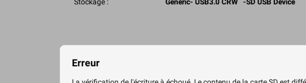

# Raspberry Pi — installation Linux sur carte microSD (Fatlab)

**Date :** 6 novembre 2026  
**Statut :** préparation en cours ; écriture et démarrage non encore confirmés.  
**Contexte :** atelier Fatlab, installation de Linux sur Raspberry Pi avec lecteur de carte SD USB, après une première tentative avec une clé USB.

## Matériel et outil observés
- Raspberry Pi (modèle exact non encore identifié).
- Carte microSD dans un lecteur USB reconnu sous Windows comme `Generic- USB3.0 CRW -SD USB Device`, capacité affichée **37,3 Go**, lecteur **E:\\**.
- **Raspberry Pi Imager v2.0.12** sous Windows.

> Attention : l'écriture d'une image OS efface le contenu du support sélectionné. Vérifier que E: est bien la carte microSD avant de lancer l'écriture.

## Étapes constatées (captures du 6 novembre)
1. Ouverture de Raspberry Pi Imager.
2. Sélection de **Raspberry Pi OS (64-bit)**, version basée sur **Debian Trixie** avec bureau Raspberry Pi, affichée comme « recommandée » par Imager. Le téléchargement annoncé est d'environ 1,4 Go. **Choix constaté**, mais la compatibilité dépend du modèle de Raspberry Pi.
3. Dans « Stockage », sélection du lecteur de carte SD USB `Generic- USB3.0 CRW -SD USB Device` (37,3 Go, E:).
4. Dans « Personnalisation > Nom d'hôte », saisie de **WADA3A** (à confirmer si Imager accepte les majuscules ou normalise le nom).
5. Dans « Localisation », premier essai affichant **Zagreb (Croatia)**, fuseau **Europe/Zurich** et clavier `hr` : combinaison incohérente pour un clavier suisse ; **ne pas conserver `hr`**.
6. Capture suivante : paramètres de localisation encore vides.
7. **Capture de localisation :** **Bern (Switzerland)**, fuseau **Europe/Zurich**, disposition clavier **ch**. C'est le bon choix de pays et de disposition pour un clavier suisse ; la variante exacte (suisse français ou suisse allemand) reste à vérifier sur le clavier physique.
8. **Capture — personnalisation Wi-Fi :** mode **RÉSEAU SÉCURISÉ**, nom de réseau (SSID) **`WADA3A BINKS`**. Champs mot de passe et confirmation remplis à l'écran (masqués). **Aucun mot de passe n'est enregistré dans le dépôt**. Connexion effective du Raspberry Pi à ce Wi-Fi pas encore vérifiée.
9. **Capture — Accès à distance / authentification SSH :** écran « Configurer l'accès SSH » atteint. Interrupteur **Activer SSH désactivé** sur la première capture ; options proposées : mot de passe ou clé publique. Sur la **nouvelle capture**, l'option **« Utiliser un mot de passe pour l'authentification » est sélectionnée** (bouton radio bleu). **L'activation effective de SSH et le fonctionnement d'une connexion restent à vérifier.** Explication apportée : adresse IP = appareil, port = service sur l'appareil, TCP = transport fiable des données, SSH = terminal distant sécurisé. Ces notions sont **en découverte, non évaluées ni maîtrisées**.

10. **Capture — Raspberry Pi Connect (après l'étape Utilisateur et Accès à distance) :** interrupteur **« Activer Raspberry Pi Connect » désactivé**. Raspberry Pi Connect est une solution d'accès distant avec compte Raspberry Pi ; elle est facultative et distincte de SSH. Aucun compte ni service Connect activé à ce stade. Le nom d'utilisateur Linux n'est **toujours pas connu/confirmé** car le contenu de l'écran « Utilisateur » n'a pas été partagé.

11. **Capture — résumé avant écriture (6 novembre 2026) :** Raspberry Pi Imager affiche maintenant **Raspberry Pi 5** comme appareil sélectionné, **Raspberry Pi OS (64-bit)** comme OS et le lecteur **Generic- USB3.0 CRW -SD USB Device** comme destination. Le résumé confirme : nom d'hôte configuré, localisation configurée, **compte utilisateur configuré** (nom exact non visible dans cette capture), Wi-Fi configuré et **SSH activé**. L'écran est à l'étape **« Écrire l'image »** ; l'écriture et la vérification **n'ont pas encore été confirmées**. Avant de cliquer sur « ÉCRIRE », s'assurer que la destination est bien la microSD attendue : son contenu sera effacé.

12. **Capture — confirmation d'effacement (6 novembre 2026) :** l'application affiche « Vous êtes sur le point d'EFFACER toutes les données sur : Generic- USB3.0 CRW -SD USB Device », avec les boutons **ANNULER** et **JE COMPRENDS, EFFACER ET ÉCRIRE**. Il faut confirmer qu'il s'agit bien de la microSD de 37,3 Go et qu'aucune donnée à conserver ne s'y trouve avant de valider. **À ce stade, l'écriture n'a pas encore été confirmée.**

13. **Capture — écriture en cours (6 novembre 2026) :** l'utilisateur a confirmé l'effacement puis lancé l'écriture de Raspberry Pi OS 64 bits sur la microSD. **Progression observée : 52 %**, avec message « Écriture en cours — ne pas débrancher le périphérique de stockage » et indication d'une limite par la vitesse du périphérique de stockage (**21 MB/s**). **Opération non terminée au moment de la capture** : attendre la fin de l'écriture et l'éventuelle vérification avant de retirer la carte.

## Vérifications encore à faire
- **Modèle confirmé dans le résumé Imager : Raspberry Pi 5**, compatible avec Raspberry Pi OS 64 bits.
- Vérifier les paramètres utilisateur et l'éventuel accès SSH en évitant de publier mots de passe et secrets ; confirmer ultérieurement la connexion effective au Wi-Fi `WADA3A BINKS`.
- Lancer l'écriture sur la microSD, attendre la vérification de l'image par Imager.
- Insérer la microSD dans le Raspberry Pi, brancher l'alimentation et constater le premier démarrage.
- Contrôler Linux et le clavier sur l'appareil, par exemple avec `uname -a`, `cat /etc/os-release` et un test de frappe.
- Ajouter les preuves des étapes réellement réussies, sans déclarer l'installation terminée avant le premier démarrage.

## Compétences travaillées
- Reconnaître OS, support de stockage et architecture 64 bits.
- Préparer un support de démarrage Linux avec Raspberry Pi Imager.
- Configurer localisation, fuseau horaire et clavier.
- Suivre un diagnostic de manière reproductible, avec captures et vérification indépendante.

**Note de suivi :** compléter ce journal au fur et à mesure des nouvelles captures envoyées depuis le Fatlab.

## Mini-quiz réseau et SSH (6 novembre 2026)
- **IP et port** : à la question « que représente 22 dans 192.168.1.20:22 ? », réponse **B (port SSH)** : correcte.
- **TCP** : à la question « que fait TCP lorsque des données se perdent ? », réponse **B (retransmettre les données perdues)** : correcte.
- **Lien IP + port** : à la question « pourquoi faut-il l'adresse IP et le port pour SSH ? », réponse **A (IP = appareil ; port = service)** : correcte. Notion comprise dans ce quiz, à revoir en situation réelle.
- **Commande SSH** : à la question « que signifie `ssh` dans `ssh utilisateur@192.168.1.20` ? », réponse **B (établir une connexion sécurisée à distance)** : correcte. Compréhension théorique confirmée par quiz ; connexion pratique encore à tester.
- **À consolider** : TCP utilise des accusés de réception et des mécanismes de retransmission ; la notion reste **en apprentissage**, pas encore déclarée maîtrisée.

- **Réponse libre (mise en situation SSH)** : l'apprenant explique qu'il faut passer par le réseau depuis le terminal Windows pour se connecter au Raspberry Pi, en utilisant le nom de l'appareil ; **principe général compris**. À pratiquer : syntaxe `ssh utilisateur@wada3a.local` (ou adresse IP si le nom ne se résout pas), vérifier l'activation SSH, le nom d'utilisateur et la connexion réseau. Aucune connexion SSH effective encore démontrée.

## Incident d'ecriture et nouvelle tentative (6 novembre 2026)

- Premiere ecriture lancee, progression observee a 52 %.
- A la verification, Imager a affiche une erreur : le contenu de la carte SD est different de ce qui a ete ecrit. Le support n'est donc pas valide.
- Apres le bouton Continuer, retour a la selection du systeme d'exploitation.
- Choix conseille pour la nouvelle tentative : Raspberry Pi OS (64-bit), version standard avec bureau, adapte au Raspberry Pi 5. Le message d'echec ne demontre pas un probleme de version 64 bits.
- Diagnostic a poursuivre si le probleme se repete : essayer un autre port USB, un autre lecteur ou une autre carte microSD, puis confirmer que la verification termine correctement.
- Preuves visuelles : captures fournies dans le dialogue, fichiers PNG pas encore ajoutes dans ce depot.

## Diagnostic Windows apres erreur de verification (6 novembre 2026)

Capture PowerShell : commande non destructive `Get-Disk`.

- Disque 0 : disque interne SK hynix, environ 953,87 Go, GPT. **Ne pas modifier.**
- Disque 1 : lecteur USB `Generic- U...` affiche **No Media**, 0 B (lecteur sans support dans cet emplacement).
- Disque 2 : lecteur USB `Generic- U...`, **Online**, environ **34,73 Go**, style de partition **MBR**, statut affiche **Healthy**. Candidat coherent avec la carte microSD de 37,3 Go presentee par Imager (difference d'unites et d'arrondi).
- **Interprétation prudente** : le disque 2 est reconnu, mais `Healthy` ne prouve **pas** que les donnees sont integres ni que la carte est fiable ; l'echec de verification d'Imager reste a diagnostiquer.
- **Prochaine verification en lecture seule** : `Get-Partition -DiskNumber 2` pour afficher le decoupage actuel du stockage. Ne pas lancer de formatage ni `Initialize-Disk`, `Clear-Disk` ou `diskpart clean`.
- **Preuve** : capture fournie dans la conversation, image binaire non encore ajoutee sur GitHub.

## Preuve visuelle : diagnostic PowerShell réalisé


**Résultat observé personnellement :** la commande `Get-Partition -DiskNumber 2` identifie **une seule partition**, n° 1, **34,73 Go**, type indiqué **FAT16**, sans lettre de lecteur. Ce résultat **n'est pas le partitionnement habituel d'une installation Raspberry Pi OS complète** (qui comporte normalement une partition de démarrage FAT et une partition Linux). La commande ne valide ni l'intégrité de la carte ni le bon fonctionnement du système. **Le diagnostic n'est pas terminé.** La capture a été recadrée pour éviter de publier les identifiants du périphérique.

**Progression autonome :** exécution de `Get-Disk`, puis `Get-Partition -DiskNumber 2`, lecture des résultats sous Windows PowerShell. Assistance : commandes proposées et interprétation accompagnée, sans attribuer à tort une autonomie complète.

## Preuve visuelle : échec de vérification de la microSD



Cette capture montre le message d'échec après écriture : le contenu relu sur la carte SD diffère du contenu écrit. Elle constitue une preuve de l'incident, pas d'une installation réussie. Les preuves sont des captures sélectionnées et recadrées pour documenter les événements techniques importants.

## Observation supplémentaire : catalogue hors ligne et mauvais fichier ISO

Une capture ultérieure montre « Unable to download OS list » dans Raspberry Pi Imager. Le titre de la fenêtre mentionne `ubuntu-26.04.1-desktop-amd64.iso`, destiné aux PC x86-64 et non au Raspberry Pi 5 (ARM64). La section « Options app > Dépôt de contenu » sert à régler la source du catalogue d'images et non la destination de l'installation. Conserver « Raspberry Pi (default) » et réessayer le chargement du catalogue ; une image locale doit être conçue pour Raspberry Pi 5. Cet incident réseau est distinct de l'échec de vérification d'écriture.

## Diagnostic des lettres de lecteur (6 novembre 2026)

- `Get-CimInstance -ClassName Win32_LogicalDisk | Where-Object {$_.DriveType -eq 2}` affiche seulement `D:` comme lecteur amovible, sans taille.
- `Get-ChildItem -Path E:\\` renvoie `DriveNotFoundException` : aucune lettre `E:` n'est actuellement montée dans Windows.
- `Get-Partition -DiskNumber 2` indique un disque de 34,73 Go avec une partition sans lettre de lecteur.
- **Interprétation** : `D:` peut être un emplacement de lecteur amovible sans média, et n'est pas encore identifié comme la carte de 34,73 Go. La carte est détectée comme disque physique n° 2, mais n'est pas montée sous `E:`. Aucun formatage ni changement de lettre effectué.
- **Prochaine commande en lecture seule** : `Get-Volume | Format-Table DriveLetter,FileSystemLabel,FileSystem,Size,HealthStatus -AutoSize` ; poursuivre le lien disque/volume sans supposer que `D:` est la microSD.

## Diagnostic PowerShell — Get-Volume (6 novembre 2026)

**Preuve reçue** : capture PowerShell avec essais de lecture `E:\\` et `D:\\`, puis `Get-Volume`.

- `Get-ChildItem -Path E:\\` : `DriveNotFoundException`, lecteur E absent.
- `Get-ChildItem -Path D:\\` : `ItemNotFoundException`, chemin D indisponible.
- `Get-Volume` : `D:` est un lecteur amovible de **0 B**, système de fichiers `Unknown` et état opérationnel `Unknown` ; un second volume amovible sans lettre apparaît également à **0 B / Unknown**. Le volume Windows `C:` en NTFS est sain.
- **Conclusion prudente** : `D:` n'est pas une preuve de montage de la carte microSD de 34,73 Go. Le lecteur de carte peut annoncer un emplacement sans média ou un volume illisible ; la carte physique est cependant reconnue comme `Disk 2` par `Get-Disk`. Il est impossible de conclure à une défaillance matérielle à partir de ces seules commandes.
- Étape diagnostique conseillée, non destructive : `Get-Partition -DiskNumber 2 | Get-Volume` pour inspecter directement l'association de la partition du disque 2 à un volume, sans changer de lettre ni formater.
- L'échec antérieur de vérification Raspberry Pi Imager reste ouvert. Le statut `Healthy` dans `Get-Disk`/`Get-Volume` ne garantit pas l'intégrité des données.
- **Preuve image fournie dans la conversation ; cette nouvelle capture PNG n'est pas encore publiée dans GitHub.**

## DiskPart — inspection sans effacement (6 novembre 2026)

Capture fournie : dans `diskpart`, la commande `list disk` retourne disque 0 **953 Go (GPT)**, disque 1 **aucun média (0 octet)** et disque 2 **en ligne, 34 Go**. L'utilisateur a lui-même ouvert DiskPart et exécuté `list disk`. La prochaine commande proposée est `select disk 2`, qui **sélectionne seulement** le disque cible pour lecture, avant `detail disk` et `list partition` ; éviter `clean`, `format`, `delete partition` et toute écriture tant que le diagnostic n'est pas terminé. Attention : le disque 0 est le disque Windows.

**Deux incidents distincts** : (a) Raspberry Pi Imager n'a pas pu **vérifier l'écriture sur microSD** ; (b) Imager a ensuite affiché **« Unable to download OS list »**, relatif au catalogue en ligne. L'ISO `ubuntu-26.04.1-desktop-amd64.iso` montrée est pour PC x86-64 et non pour Raspberry Pi 5 ARM64. Observer la table de partitions n'expliquera pas à lui seul l'échec du téléchargement de la liste OS.

**Preuve visuelle de cette étape** : capture reçue, fichier PNG non encore publié dans le dépôt.

## DiskPart — détail du disque 2 (6 novembre 2026)

Commandes réellement exécutées par l'apprenant : `list disk`, `select disk 2`, puis `detail disk`. La sortie confirme `Generic- USB3.0 CRW -SD USB Device`, bus **USB**, disque **en ligne**, **lecture seule : Non**, volume n° 4, **34 Go**, **RAW**, **sans lettre**, statut affiché **Sain**. **Interprétation :** Windows voit le support physique mais ne reconnaît pas de système de fichiers exploitable sur ce volume. Cela correspond à l'échec antérieur de vérification de l'écriture, **sans prouver** une défaillance de la microSD ; système de fichiers corrompu/incomplet ou erreur du lecteur/support restent possibles. L'indication `Sain` n'est pas un test d'intégrité de toutes les données. La cause de l'échec de téléchargement du catalogue dans Imager est distincte et n'est pas expliquée par DiskPart. Éviter toute commande destructive sans décision explicite. **Capture fournie en conversation, non encore intégrée au dépôt.**

## Nouvelle tentative — écran de fin signalé (6 novembre 2026)

L'utilisateur rapporte que **Raspberry Pi Imager a affiché un message autorisant à éjecter le support USB** et qu'il a cliqué sur **« Terminer »**. Cela suggère que l'application considère l'opération d'écriture terminée et la carte retirable. **L'écran de fin et la vérification exacte ne sont pas visibles dans les captures reçues à ce stade ; ne pas affirmer une validation complète sans preuve.** L'image effectivement écrite pendant cette nouvelle tentative (Ubuntu ARM64 pour Raspberry Pi ou Raspberry Pi OS) n'est pas confirmée ici. Le **démarrage sur Raspberry Pi 5 n'a pas encore été vérifié**. Prochaine étape : retirer la microSD en sécurité, l'insérer dans le Raspberry Pi 5 éteint, brancher l'écran si disponible, puis l'alimentation adaptée et observer le premier démarrage. Si la microSD n'est plus dans le lecteur, ne pas chercher à lire `E:` ou `D:` sous Windows.


## ✅ Résolution confirmée — premier démarrage graphique (6 novembre 2026)

**Statut : RÉUSSI — Raspberry Pi 5 démarré sur Raspberry Pi OS (bureau graphique affiché).**

### Problème initial

Plusieurs tentatives de préparation du support de démarrage ont échoué. Les symptômes relevés comprennent une erreur de vérification d'écriture dans Raspberry Pi Imager, un support vu comme RAW/non monté par Windows, des difficultés avec plusieurs périphériques USB/SD, et un incident distinct de téléchargement du catalogue des systèmes d'exploitation. Une image Ubuntu Desktop `amd64` avait également été examinée alors que le Raspberry Pi 5 est en architecture ARM64.

### Démarche de diagnostic effectuée

1. Persévérance sur l'hypothèse d'un problème de support/lecteur, au lieu de réinstaller indéfiniment des versions de Linux.
2. Tests des supports et inspection de leur détection sous Windows avec PowerShell (`Get-Disk`, `Get-Partition`, `Get-Volume`) et DiskPart (`list disk`, `select disk 2`, `detail disk`).
3. Identification d'anomalies visibles : disque amovible de 34 Go, volume RAW sans lettre, et échecs de vérification d'écriture.
4. Changement de support : découverte d'une clé USB fonctionnelle, puis nouvelle préparation du démarrage.
5. Branchement du Raspberry Pi 5, affichage HDMI et alimentation ; vérification sur un vrai écran du démarrage jusqu'au bureau graphique de Raspberry Pi OS.

### Résultat vérifié par les photos du 6 novembre

- **Photo 1** : Raspberry Pi 5, périphérique USB inséré, HDMI et alimentation USB-C connectés, LED verte visible.
- **Photo 2** : bureau graphique de Raspberry Pi OS visible sur un moniteur externe. Ce résultat confirme le démarrage fonctionnel du système sur le Raspberry Pi 5, et non seulement l'écriture annoncée par Raspberry Pi Imager.

**Nuance technique :** les observations ne prouvent pas que Linux ait endommagé toutes les clés USB précédemment utilisées. Elles montrent qu'un changement de support a permis de lever le blocage dans cette configuration. La cause précise des échecs précédents (support, lecteur, image, corruption d'écriture ou combinaison) reste indéterminée.

### Compétences mises en pratique

- Dépannage matériel et logiciel avec formulation d'une hypothèse.
- Différence entre détection physique d'un disque et montage d'un système de fichiers.
- Identification de supports USB/SD et lecture de diagnostics Windows.
- Préparation d'un support de démarrage adapté et validation du démarrage Linux sur matériel ARM.
- Preuve du résultat par observation directe et photographies.

**Niveau : première mise en service réussie en pratique ; compétences de diagnostic en cours de consolidation.**

> **Preuves photographiques réelles :** deux photos reçues dans la conversation du 6 novembre 2026. Leur ajout binaire au dossier `preuves/` reste à effectuer. Ne pas confondre ce point de publication avec la réussite technique du démarrage.


## Suite du projet — serveur Minecraft Java / Paper (6 novembre 2026)

- **Système de base :** Raspberry Pi 5 et bureau Raspberry Pi OS démarrés avec succès (voir preuves et diagnostic ci-dessus).
- **Java :** l'apprenant indique que l'installation de Java est faite. Version et fonctionnement à contrôler avec `java -version` ; aucune sortie de commande n'a été fournie ici.
- **PaperMC :** reste à télécharger et installer ; **aucun serveur Minecraft opérationnel n'a encore été démontré**.
- **À la reprise :** vérifier `java -version`, l'architecture avec `uname -m`, puis choisir une version de Paper compatible avec la version de Java installée. Prévoir un dossier de serveur, une configuration raisonnable pour les ressources du Raspberry Pi, et accepter l'EULA seulement après lecture.
- **Point d'arrêt du 6 novembre :** l'apprenant quitte le Fatlab et poursuivra depuis chez lui. Ne pas marquer Paper comme installé avant validation pratique.

**Publication des photos :** les deux photos du Raspberry Pi en fonctionnement restent à déposer dans `preuves/`. Le présent document consigne leur observation, mais les fichiers images binaires ne sont pas encore publiés ici.


## Notes manuscrites de l'atelier — ajout du 11 novembre 2026

Deux photographies de notes personnelles ont été partagées pour enrichir ce journal. Elles documentent les notions étudiées autour du Raspberry Pi 5. **Les photographies originales ne sont pas encore publiées dans le dépôt** ; cette section est une transcription structurée des passages lisibles, pas une transcription mot à mot exhaustive.

### Feuille 1 — matériel, utilité et branchements
- Liste manuscrite « Matériel / Utilité » : alimentation (alimenter la carte), carte SD / microSD, câbles HDMI, clavier USB, ventilateur / refroidissement.
- Observation manuscrite : le système de refroidissement ne monte pas automatiquement (formulation approximative de la note ; fonctionnement exact non vérifié).
- Remarque sur le démarrage et le BIOS : à distinguer du processus de démarrage propre au Raspberry Pi, qui n'est pas le BIOS classique d'un PC.
- Schéma dessiné du Raspberry Pi et de ses connexions : HDMI, USB-C (alimentation) et ports USB.
- Une mention « OS : Ubuntu » figure sur la feuille : **ne pas la prendre comme preuve de l'OS final**, puisque le démarrage effectivement confirmé dans ce journal est Raspberry Pi OS.

### Feuille 2 — réseau et accès distant
- **Adresse IP** : identifier un appareil / une interface sur un réseau ; exemple manuscrit ressemblant à `192.168.1.20` (adresse pédagogique, non confirmée comme IP réelle du Pi).
- **Port** : identifier le service auquel on souhaite accéder sur une machine.
- **SSH** : établir une connexion distante sécurisée, notamment pour utiliser un terminal.
- **Utilisateur** : compte Linux employé pour l'authentification ; le nom exact du compte du Pi reste à confirmer.
- **Nom local** : note mentionnant `wada3a.local`, à utiliser seulement si la résolution du nom fonctionne sur le réseau local.
- **TCP** : « Transmission Control Protocol », protocole de transport fiable ; notion liée aux accusés de réception et retransmissions.
- **Authentification SSH** : notes sur la connexion par utilisateur/mot de passe et sur une paire de clés cryptographiques ; la clé publique peut être placée côté serveur, la clé privée doit rester secrète.
- **À revoir** : plusieurs formulations manuscrites sont abrégées ou difficiles à lire ; aucune connexion SSH réelle n'est démontrée par ces notes.

### Statut des preuves
- Photos fournies en conversation : `IMG_2439.jpeg` (matériel et schéma) et `IMG_2438.jpeg` (réseau/SSH/TCP).
- **Fichiers image non encore ajoutés à GitHub** : ne pas présenter cette transcription comme si les photos étaient déjà hébergées.
- Ces notes complètent la réussite du premier démarrage Raspberry Pi OS du 6 novembre ; elles ne démontrent pas l'installation de PaperMC.


## Deux nouvelles photos de preuve du démarrage — reçues le 11 novembre 2026

Deux photographies supplémentaires ont été fournies dans la conversation. Elles corroborent le **premier démarrage réussi du Raspberry Pi 5** déjà consigné au 6 novembre 2026.

1. **Photo du matériel en fonctionnement** (fichier original transmis : `IMG_9B6A67E8-5FE1-4DE3-BF25-2D5AEF7876BB.jpeg`) : carte Raspberry Pi 5 visible, câble réseau Ethernet, câble HDMI, alimentation USB-C, périphériques USB et LED verte allumée. La photo démontre le montage physique et l'alimentation ; elle ne démontre pas à elle seule l'accès Internet ou SSH.
2. **Photo de l'écran** (fichier original transmis : `IMG_E9957108-AD79-4476-A4AE-BB1FA06F2EF5.jpeg`) : bureau graphique de Raspberry Pi OS affiché sur un moniteur Dell, avec barre supérieure et environnement graphique chargé. C'est une preuve visuelle de démarrage jusqu'à la session graphique.

**Statut confirmé :** mise en service initiale de Raspberry Pi OS réussie. **Non vérifiés par ces photos :** version de Java, accès SSH, serveur Minecraft PaperMC, connectivité réseau.

**Publication des fichiers binaires :** ces deux photographies ont été reçues dans la conversation et décrites ici, mais leurs fichiers JPEG **ne sont pas encore transférés dans le répertoire GitHub `preuves/`**. Ne pas confondre l'ajout de leur description avec l'hébergement des images.


## Nouvelle étape — installation de Pi-Apps pour Minecraft (photo reçue le 11 novembre 2026)

**Objectif déclaré :** installer Pi-Apps afin de trouver et installer des applications liées au jeu Minecraft et à l'hébergement d'un serveur sur le Raspberry Pi 5.

**Preuve visuelle reçue :** photo du bureau Raspberry Pi OS avec terminal ouvert (fichier transmis en conversation : `IMG_F5ABCB43-E753-438B-B960-BA50094DF882.jpeg`).

**Observations directement visibles :**
- Session graphique Raspberry Pi OS et fenêtre de terminal ouvertes ; titre de terminal semblant indiquer l'utilisateur `wadaha` sur l'hôte `WADA3A` (lecture de la photographie à confirmer sur l'appareil).
- Installation de paquets Debian en cours : lignes `Preparing to unpack`, `Unpacking`, notamment `debconf` et `imagemagick`.
- Certains noms de paquets se terminent par `arm64`, cohérent avec l'architecture du Raspberry Pi 5.
- Indicateur de progression à **31 %** au moment de la photographie.

**Statut : EN COURS.** La photographie ne montre pas la fin de l'installation, l'ouverture de Pi-Apps, ni l'installation de Minecraft ou d'un serveur PaperMC. Ne pas les déclarer réussis sans validation supplémentaire.

**Prochaine vérification :** laisser finir le processus, observer le message final et confirmer que Pi-Apps s'ouvre. Ensuite distinguer l'installation d'un client Minecraft de celle d'un serveur Java/PaperMC.

**Publication de la photo :** son contenu est décrit ici, mais le JPEG original n'a pas encore été ajouté au dossier GitHub `preuves/`.


## Préparation Minecraft / PaperMC — installation Java 21 (11 novembre 2026)

**Intention annoncée :** installer PaperMC sur Raspberry Pi 5 pour héberger un serveur Minecraft. Deux nouvelles photos ont été fournies en conversation.

- **Capture du terminal** (`IMG_14F14997-6A2D-4D0E-AFA6-2C3AF6EB6538.jpeg`) : l'installation des paquets précédents affiche `done`, puis le gestionnaire APT propose d'installer `default-jre` et des dépendances, notamment `openjdk-21-jre` et `openjdk-21-jre-headless`. Résumé visible : **8 paquets à installer**, **41,2 Mo à télécharger**, **205 Mo d'espace nécessaires**, **233 Go disponibles**. L'invite est arrêtée à `Continue? [Y/n]` : **Java 21 n'est pas encore confirmé installé à cet instant**.
- **Photo du tutoriel** (`IMG_133F21B6-195E-494E-95EB-57D5CB31828A.jpeg`) : page RaspberryTips présentant l'installation de Pi-Apps via un script hébergé sur GitHub. La photo montre les instructions d'un site web, pas la confirmation de leur exécution sur l'appareil.

**Statut technique :** préparation du serveur Minecraft en cours ; l'installation de Java attend confirmation. Pi-Apps n'est pas confirmé fonctionnel par ces captures, et **aucun téléchargement ou démarrage de PaperMC n'est visible**.

**Prochaine vérification :** confirmer l'installation APT, attendre sa fin puis lancer `java -version`. Ensuite seulement vérifier la compatibilité de la version de Java avec la version de Paper souhaitée, et installer PaperMC séparément.

**Preuves :** les deux JPEG sont reçus dans la conversation ; les originaux ne sont pas encore publiés dans `preuves/` sur GitHub.


## Java 21 — installation terminée (capture du 11 novembre 2026)

Une nouvelle photographie du terminal Raspberry Pi OS a été reçue : `IMG_63033E67-0304-4BD3-A002-19DA375B8B28.jpeg`.

**Constats visibles :**
- `Setting up openjdk-21-jre:arm64 (21.0.13+9-1~deb13u2) ...`
- `Setting up default-jre-headless (2:1.21-76) ...`
- `Setting up default-jre (2:1.21-76) ...`
- Retour à l'invite de commande `wadaha@WADA3A:~ $` sans erreur visible en fin de sortie.

**Statut : installation APT de Java 21 terminée avec succès apparent.** Vérification d'exécution à faire avec `java -version` ; la capture ne montre pas encore cette commande. **PaperMC n'est pas encore installé ni lancé d'après les preuves disponibles.**

**Prochaine action :** exécuter `java -version` et conserver sa sortie comme preuve. Le fichier JPEG original est reçu dans la conversation mais n'est pas encore hébergé dans le dépôt GitHub.


## Historique réel des commandes Linux — photo du 11 novembre 2026

**Source :** photographie de la commande `history` dans un terminal Raspberry Pi OS, fichier partagé en conversation `IMG_AFA9F700-98B4-4145-9E12-9D5B6EE2F8C9.jpeg`. L'image montre les entrées numérotées **1 à 28** ; la ligne 29 est coupée. Les commandes ci-dessous sont retranscrites telles qu'elles sont lisibles, **y compris les essais potentiellement erronés**. Une commande dans l'historique prouve sa saisie, pas son succès.

```bash
 1  lsblk
 2  uname
 3  uname -r
 4  man uname
 5  man lsblk
 6  reboot
 7  wget -qO- https://raw.githubusercontent.com/Botspot/pi-apps/master/install | bash
 8  sensors
 9  vcgencmd measure_temp
10  sudo apt update
11  sudo apt upgrade
12  sudo apt install default-jre
13  mkdir /home/pat/minecraft
14  cp paper-1.20.4-373.jar /home/pat/minecraft/~
15  cd /home/pat/minecraft/
16  java -jar paper-1.20.4-373.jar~
17  cd /home/pat/minecraft/
18  java -jar paper-1.20.4-373.jar~
19  cd /home/pat/minecraft/
20  java -jar paper-1.20.4-373.jar
21  cd Documents/
22  ls
23  java -version
24  java -Xms12G -Xmx12G -jar paper-26.3-248.jar --nogui
25  ls
26  ls -l
27  man ls
28  cd Documents/
```

**Points d'apprentissage et vérifications :**
- Les commandes `lsblk`, `uname`, `man`, `sensors` et `vcgencmd measure_temp` montrent des essais de découverte du matériel, du noyau et de la température.
- Pi-Apps a fait l'objet d'une commande d'installation ; sa réussite n'est pas démontrée par cette seule photo.
- `sudo apt update`, `sudo apt upgrade` et `sudo apt install default-jre` montrent le travail de maintenance et l'installation de Java ; la réussite de Java 21 est corroborée par une autre capture du journal.
- Les chemins `/home/pat/minecraft` apparaissent dans l'historique, alors que l'invite visible sur la photo indique `wadaha@WADA3A` : **vérifier l'existence de ce répertoire et ne pas supposer que `pat` est l'utilisateur courant**.
- Les commandes se terminant par `.jar~` et le chemin de destination `/home/pat/minecraft/~` sont conservés comme saisis ; ils peuvent correspondre à des erreurs de nom ou de chemin.
- La commande `java -Xms12G -Xmx12G -jar paper-26.3-248.jar --nogui` demande **12 Go de RAM minimum et maximum** : quantité à vérifier par rapport à la RAM réelle du Raspberry Pi avant toute relance. La compatibilité de ce fichier Paper avec Java 21 doit aussi être vérifiée.
- **Aucun démarrage réussi de PaperMC n'est prouvé** par l'historique seul : il faut une sortie du serveur, l'apparition des fichiers de configuration et un message de disponibilité.
- **Photo originale :** reçue dans la conversation, mais non encore publiée comme fichier JPEG dans le dossier GitHub `preuves/`.

**Prochaine vérification sûre, sans relancer le serveur :** depuis le terminal, examiner le répertoire courant avec `pwd`, les fichiers avec `ls -lh`, et la RAM avec `free -h`.


## Session du 13 novembre 2026 — SSH depuis Windows (preuves photographiques)

**Statut observé : connexion SSH au Raspberry Pi réussie depuis PowerShell, génération d'une clé SSH Ed25519 et essai d'installation de la clé publique.** Les captures ne constituent pas à elles seules une preuve qu'une connexion *sans mot de passe* a été validée : ce test reste à refaire séparément.

### Étapes illustrées dans les captures originales

1. Essais initiaux avec le nom d'hôte local `raspberry.local` : résolution de nom impossible à ce moment-là. Cela n'implique pas que le Raspberry Pi soit hors ligne.
2. Première connexion à l'adresse IPv4 locale du Raspberry Pi : avertissement normal sur l'authenticité d'un hôte SSH encore inconnu, puis ajout de son empreinte au fichier Windows `known_hosts`.
3. Ouverture d'une session Debian GNU/Linux sur le Raspberry Pi, visible au prompt Linux. La connexion distante par SSH est donc **pratiquée et réussie**.
4. Génération côté Windows d'une paire de clés `ed25519` avec `ssh-keygen -t ed25519`, dans le dossier personnel `.ssh` ; identification de la différence entre clé privée et clé publique.
5. Envoi du contenu de la **clé publique seulement** vers le fichier Linux `~/.ssh/authorized_keys` via une commande PowerShell et SSH, puis saisie du mot de passe de la session existante. La clé privée ne doit jamais être publiée.
6. Dernière capture : prompt Linux Debian après connexion SSH. L'ouverture de session SSH est prouvée, mais pas l'authentification par clé sans mot de passe.

**Prochain contrôle reproductible :** ouvrir un nouveau terminal Windows et tenter `ssh utilisateur@adresse-ip-locale` ; vérifier si la connexion utilise bien la clé sans redemander le mot de passe du compte Linux. Les noms et adresses exacts ont été omis de ce résumé public.

### Publication des images

Les **13 captures d'écran de la session du 13 novembre** ont été reçues et préparées en dehors du dépôt. **Leurs fichiers binaires ne sont pas encore publiés sur GitHub** : ne pas présenter cette documentation comme une galerie photographique en ligne tant que les PNG n'ont pas été ajoutés au dossier `preuves/ssh-2026-11-13/`. Avant publication publique, masquer les détails non nécessaires (utilisateurs, IP internes, empreintes de clés éventuelles, chemins sensibles).


## 13 novembre 2026 — installation d'une pile web Apache / MariaDB / PHP

**Contexte :** depuis un terminal Linux sur Raspberry Pi 5 (Debian ARM64), installation d'outils pour héberger une application web. Cela constitue un **projet de serveur web**, distinct du projet de serveur Minecraft PaperMC.

### Commandes indiquées par l'apprenant

```bash
sudo apt install apache2 -y
sudo apt install mariadb-server php-mysql -y
sudo apt install php libapache2-mod-php -y
```

- **Apache2** : serveur HTTP qui répond aux requêtes d'un navigateur.
- **MariaDB** : base de données relationnelle qui stocke des informations.
- **php-mysql** : module qui permet à PHP de communiquer avec MySQL/MariaDB.
- **PHP** : langage exécuté côté serveur pour produire du contenu dynamique.
- **libapache2-mod-php** : intégration de PHP à Apache.
- **`sudo`** : exécution avec privilèges administrateur ; **`apt install`** : installation via le gestionnaire de paquets Debian ; **`-y`** : répond oui aux confirmations d'apt.

### Preuves observées dans les captures

- Capture précédente : fin d'installation d'Apache2, configuration et activation de modules, retour au prompt Linux.
- Capture du 13 novembre vers 13 h : installation PHP 8.4 terminée ; lignes `Setting up php8.4-cli`, `Setting up libapache2-mod-php8.4` et `Setting up php8.4`, configuration du module Apache et **retour au prompt `wadaha@WADA3A:~ $`**, sans erreur visible.
- L'apprenant indique avoir également exécuté `sudo apt install mariadb-server php-mysql -y`, mais la capture transmise ne montre **pas** le résultat de cette commande : installation de MariaDB et de php-mysql **à vérifier**.

### État de validation — ne pas confondre installation et fonctionnement

| Composant | Ce que l'on sait | Ce qui reste à tester |
|---|---|---|
| Apache2 | Installation terminée visible dans la capture précédente | `systemctl is-active apache2` puis réponse HTTP |
| PHP 8.4 | Installation et configuration du module Apache visibles | `php -v` et test d'une page PHP servie par Apache |
| MariaDB | Commande d'installation déclarée | `systemctl is-active mariadb` et version |
| php-mysql | Commande d'installation déclarée | `php -m` pour vérifier `mysqli` / `pdo_mysql` |

**Prochaine action prioritaire :** `sudo systemctl status apache2` pour vérifier si Apache2 est démarré ; la présence du logiciel ne suffit pas à prouver que le service tourne.

**Confidentialité :** ne pas publier de mots de passe, clés SSH privées, jetons, ou données d'administration. La capture originale a été reçue dans la conversation, mais son fichier image binaire n'est **pas encore intégré au dépôt GitHub**.
