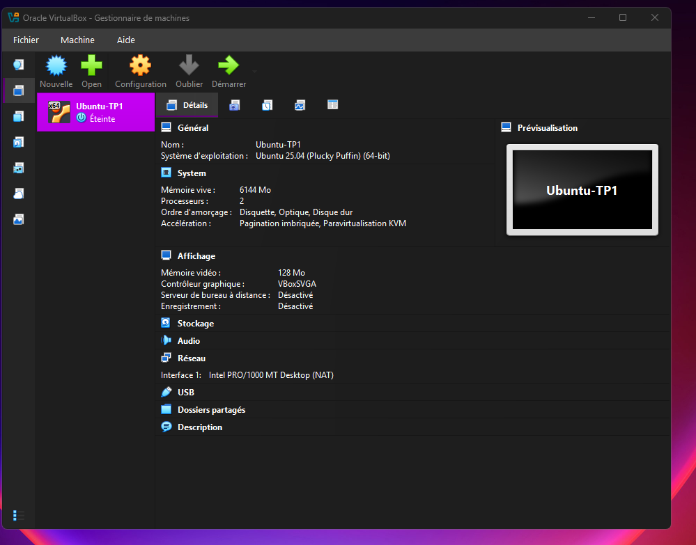

# Première VM Ubuntu — Ubuntu-TP1

**Date :** 2 novembre 2026  
**État :** VM créée ; démarrage de l’installation à vérifier.

## Objectif

Créer un ordinateur virtuel pour apprendre Linux sans installer Ubuntu directement sur le PC Windows.

## Configuration préparée

- Hyperviseur : Oracle VirtualBox
- Nom de la VM : Ubuntu-TP1
- Image d’installation attachée : ubuntu-26.04.1-desktop-amd64.iso
- Mémoire vive attribuée : 6 144 Mo
- Processeurs virtuels : 2
- Disque virtuel : 40 Go
- Réseau : NAT
- Mémoire vidéo : 128 Mo
- Contrôleur graphique : VBoxSVGA
- Accélération 3D : désactivée
- Installation automatique : désactivée ; installation manuelle prévue

## Dépannage du démarrage

Au premier essai, Ubuntu est resté sur un écran violet/noir et a affiché des messages liés à l’affichage virtuel. La VM a ensuite été arrêtée. Les réglages d’affichage ont été modifiés avant le nouvel essai.

La capture ci-dessous montre la VM arrêtée avec les réglages **VBoxSVGA** et **128 Mo** appliqués. Le démarrage après ce changement n’a pas encore été confirmé.

## Prochaine manipulation

1. Démarrer la VM en mode graphique.
2. Vérifier si le menu d’Ubuntu puis l’écran d’installation s’affichent.
3. Si l’installation s’ouvre, suivre les étapes à l’écran et garder les captures utiles.

## Ce que cela démontre pour l’instant

La VM a été créée et ses ressources ont été configurées. **Ubuntu n’est pas encore installé** : les notions Linux ne sont donc pas indiquées comme maîtrisées.
