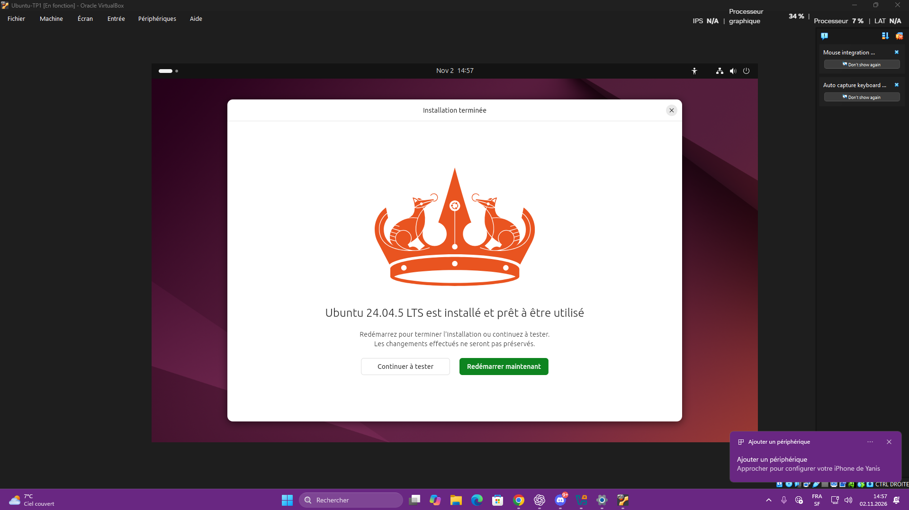
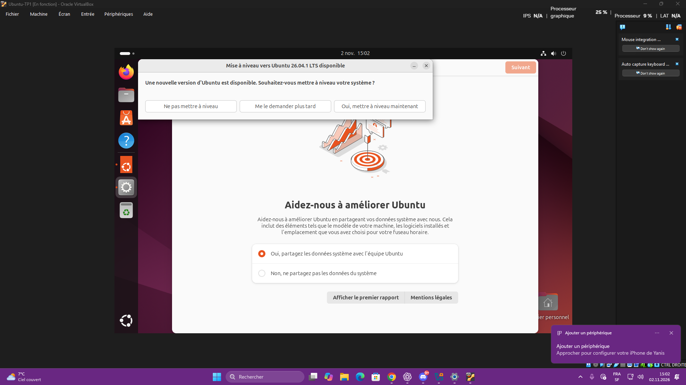

# Première VM Ubuntu — Ubuntu-TP1

**Date :** 2 novembre 2026  
**État :** Ubuntu 24.04.5 LTS installé ; premier démarrage après installation confirmé par une capture du bureau.

## Objectif

Créer un ordinateur virtuel pour apprendre Linux sur un PC Windows, avec accompagnement.

## Configuration finale

| Élément | Réglage |
|---|---|
| Hyperviseur | Oracle VirtualBox |
| VM | Ubuntu-TP1 |
| ISO utilisée | ubuntu-24.04.5.1-desktop-amd64.iso |
| Version affichée par l’installateur | Ubuntu 24.04.5 LTS |
| RAM | 6 144 Mo |
| Processeurs virtuels | 2 |
| Disque virtuel | 40 Go, Ubuntu-TP1.vdi |
| Réseau | NAT |
| Affichage | VMSVGA, 128 Mo, accélération 3D désactivée |
| Installation | Interactive, applications par défaut |
| Fuseau horaire | Europe/Zurich |
| Compte | Local, sans Active Directory |

## Dépannage et résultat

1. Le premier essai avec Ubuntu 26.04.1 a affiché un avertissement vmwgfx, puis un écran violet/noir.
2. L’augmentation de la mémoire vidéo et un essai avec VBoxSVGA n’ont pas suffi.
3. L’ISO a été remplacée par Ubuntu 24.04.5.1. Le contrôleur a été remis sur VMSVGA, conformément à l’avertissement de VirtualBox.
4. Le démarrage normal a encore affiché un écran noir. Après réinitialisation, le mode « Ubuntu (safe graphics) » a été proposé comme essai.
5. L’installateur graphique s’est ouvert, puis l’installation et le premier démarrage sur le bureau ont réussi.

**Limite du diagnostic :** la sélection effective de « safe graphics » n’est pas confirmée par les captures. La cause exacte du blocage reste inconnue ; on ne peut pas attribuer la réussite à un seul réglage.

Windows a également bloqué l’ouverture directe de l’ISO avec le Contrôle intelligent des applications. Le fichier a été sélectionné depuis le lecteur optique de VirtualBox ; aucune désactivation de la protection Windows n’a été nécessaire.

## Preuves

### Installation terminée

### Premier bureau après installation

Cette dernière capture montre une proposition de passage vers Ubuntu 26.04.1 ; elle ne prouve pas qu’une mise à niveau a été effectuée. La consigne donnée était de conserver Ubuntu 24.04.

L’ancienne [capture de configuration](captures/vm-configuration.png) conserve la trace de l’essai VBoxSVGA ; elle ne représente pas la configuration finale.

## Notions abordées

- Rôle d’un système d’exploitation ; Ubuntu comme distribution Linux.
- Différence entre le PC Windows et la machine virtuelle.
- ISO comme support d’installation virtuel ; disque VDI pour conserver le système et les fichiers.
- Attribution de RAM, processeurs et mémoire vidéo à une VM.
- Différence entre langue de l’interface et disposition du clavier.
- Compte local et introduction au rôle d’Active Directory.
- Recherche de texte dans une page avec Ctrl + F.
- Lecture d’un avertissement et vérification du résultat après modification.

Ces notions ont été abordées pendant une installation guidée ; la maîtrise autonome des commandes et de l’administration Linux reste à développer.

## Point de reprise

- Terminer les écrans de bienvenue si nécessaire.
- Vérifier le clavier suisse QWERTZ dans Ubuntu : une saisie AZERTY a été observée pendant l’installation, et sa correction finale reste à confirmer.
- Créer un dossier Lab-Linux, puis apprendre les premières commandes avec des exercices concrets.
- Vérifier la connexion Internet et effectuer les mises à jour de la version installée.

Pour arrêter : enregistrer le travail, puis utiliser le menu d’alimentation d’Ubuntu → Éteindre. Pour reprendre : ouvrir VirtualBox → Ubuntu-TP1 → Démarrer.
