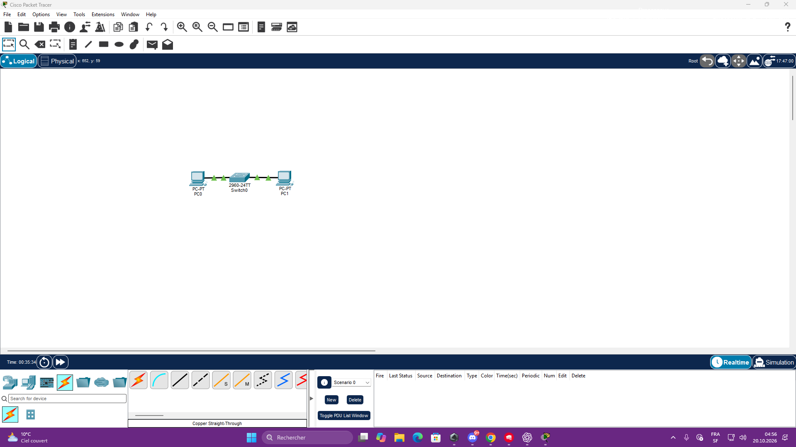
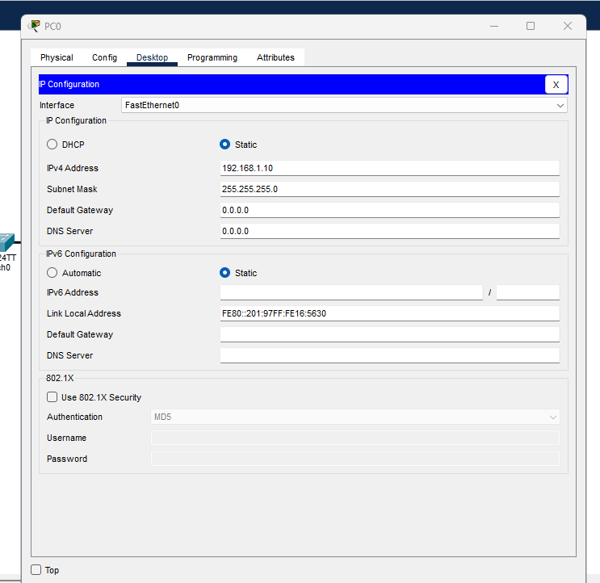
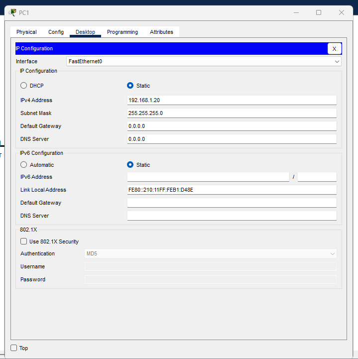
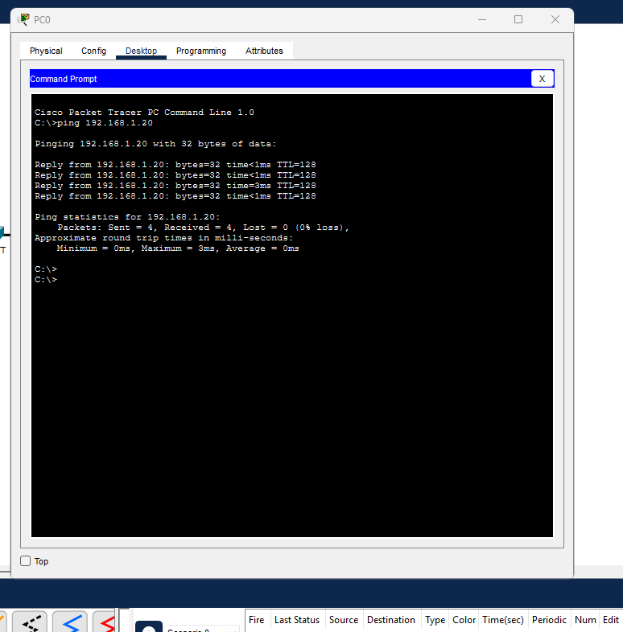
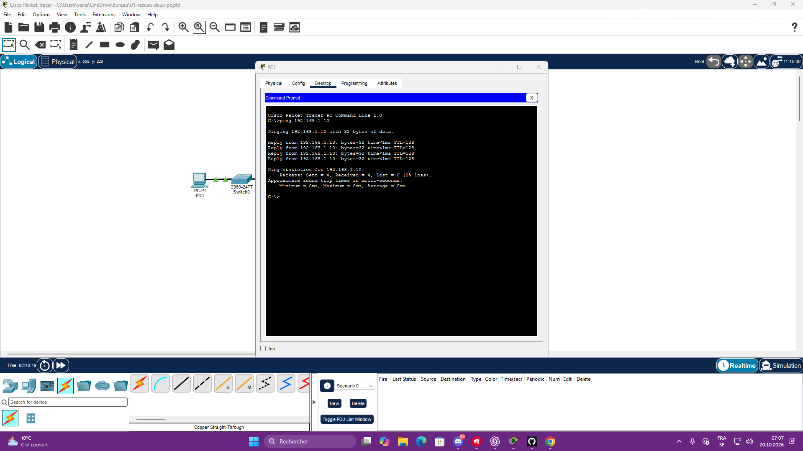

# Réseau local : deux PC et un switch

Exercice réalisé le 20 octobre 2026 dans Cisco Packet Tracer, avec accompagnement IA.

## Objectif et réalisation

Faire communiquer PC0 et PC1 à travers un switch Cisco 2960-24TT. Les deux ordinateurs sont reliés au switch avec des câbles Ethernet droits (Copper Straight-Through). Les deux liaisons présentent des voyants verts.



## Adressage manuel

| Appareil | IPv4 | Masque |
|---|---|---|
| PC0 | 192.168.1.10 | 255.255.255.0 |
| PC1 | 192.168.1.20 | 255.255.255.0 |

Mode **Static** sur les deux PC. Passerelle et DNS laissés à 0.0.0.0 : cet exercice utilise uniquement le réseau local, sans routeur ni service DNS.

### PC0


### PC1


## Test et résultat

Commande exécutée depuis **PC0 → Desktop → Command Prompt** :

```text
ping 192.168.1.20
```

Résultat observé :

```text
Packets: Sent = 4, Received = 4, Lost = 0 (0% loss)
```

PC0 a reçu les quatre réponses de PC1. La communication entre les deux PC est validée dans cette simulation.



## Notions travaillées

- **Adresse IP** : adresse utilisée pour identifier l'interface d'un appareil et le joindre sur le réseau.
- **Masque** : indique la partie réseau de l'adresse. Avec 255.255.255.0, les trois premiers nombres constituent la partie réseau.
- **Ping** : teste si un appareil répond à des demandes ICMP.
- Deux appareils de ce réseau doivent avoir des adresses distinctes.

Ces notions restent à consolider par une reproduction autonome de l'exercice.

## Difficultés corrigées

- Câble console confondu avec câble Ethernet : sélection du câble droit et des ports FastEthernet.
- Voyant orange temporaire du switch : attente du passage au vert pendant la transition STP.

## Test inverse : PC1 vers PC0

Commande exécutée depuis **PC1 → Desktop → Command Prompt** :

```text
ping 192.168.1.10
```

Résultat observé : **4 demandes envoyées, 4 réponses reçues, 0 perte (0 %)**. Les tests ping sont donc réussis dans les deux sens.



## Sauvegarde

[Ouvrir ou télécharger le projet Packet Tracer](01-reseau-deux-pc.pkt) — à ouvrir avec Cisco Packet Tracer.

## Suite

- Refaire la configuration avec moins d'aide et expliquer le rôle des adresses IP, du masque et du ping.
