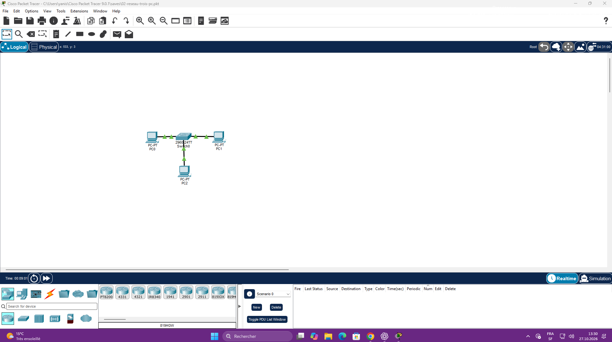
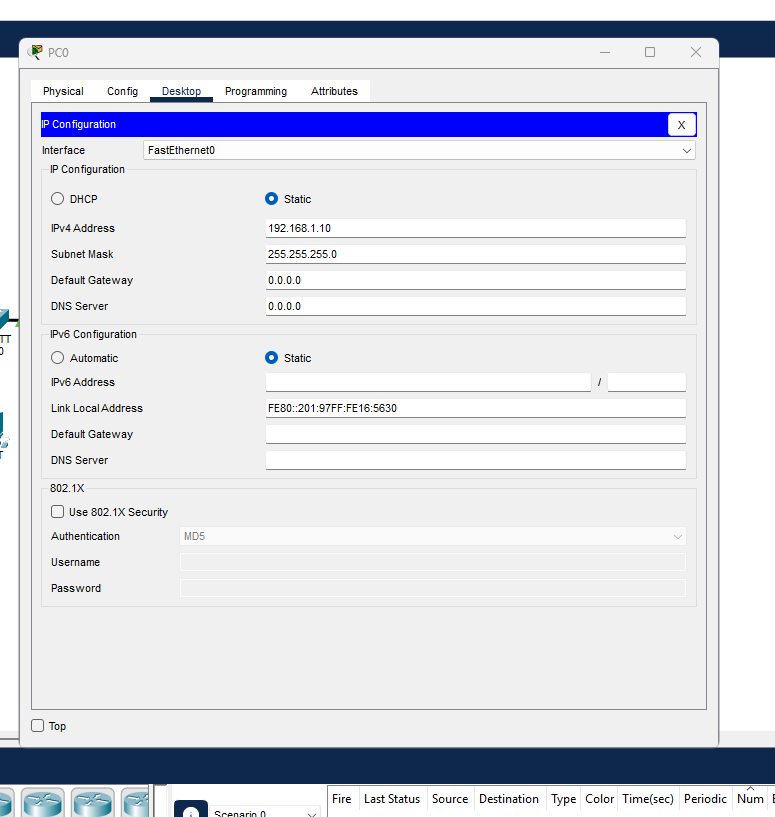
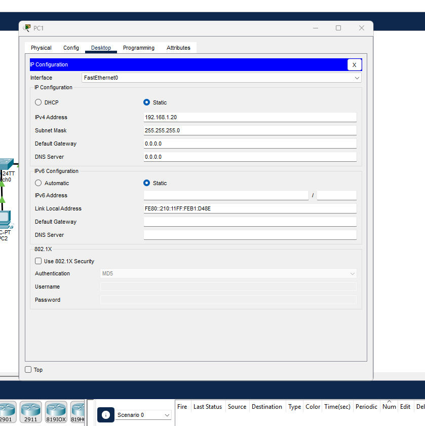
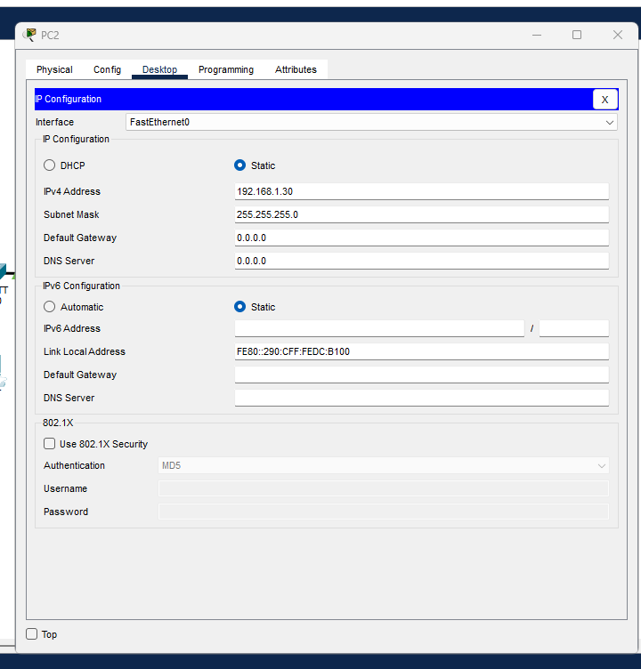
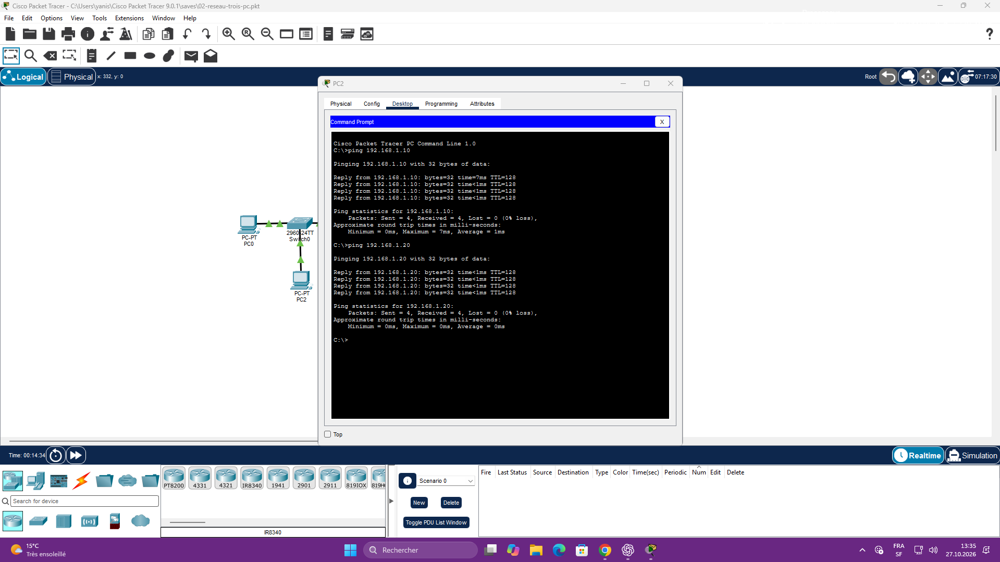

# Réseau local : trois PC et un switch

Étape documentée le 27 octobre 2026 dans Cisco Packet Tracer, avec accompagnement IA. Les résultats ci-dessous sont vérifiés sur les captures de la séance ; ils ne constituent pas une validation de maîtrise autonome.

## Situation et objectif

Étendre le premier réseau à trois PC reliés au switch Cisco 2960-24TT et tester la communication depuis PC2 vers les deux autres PC. Les trois liaisons présentent des voyants verts sur la capture finale de topologie.



## Configuration vérifiée

| Appareil | Adresse IPv4 | Masque | Mode |
|---|---|---|---|
| PC0 | 192.168.1.10 | 255.255.255.0 | Static |
| PC1 | 192.168.1.20 | 255.255.255.0 | Static |
| PC2 | 192.168.1.30 | 255.255.255.0 | Static |

Passerelle et DNS sont à `0.0.0.0` sur les trois PC. Aucun routeur ni service DNS n'est utilisé dans cet exercice local.

Avec ce masque, les trois PC appartiennent au réseau `192.168.1.0/24`. Les trois premiers octets forment la partie réseau ; le dernier distingue les appareils dans ce réseau. Chaque PC possède une adresse différente.





## Tests réalisés depuis PC2

Dans **Desktop → Command Prompt** :

```text
ping 192.168.1.10
ping 192.168.1.20
```

| Source | Destination | Envoyés | Reçus | Perdus | Conclusion |
|---|---|---|---|---|---|
| PC2 | PC0 — 192.168.1.10 | 4 | 4 | 0 (0 %) | Réussi |
| PC2 | PC1 — 192.168.1.20 | 4 | 4 | 0 (0 %) | Réussi |



Ces tests établissent que PC2 reçoit les réponses ICMP de PC0 et PC1. Aucun test direct entre PC0 et PC1 n'a été présenté pour cette version à trois PC. Le premier exercice à deux PC dispose de ses propres preuves dans le dossier précédent.

## Notions travaillées et à consolider

- Une IP distincte pour chaque interface du réseau.
- Le rôle du masque pour identifier le réseau auquel appartient une adresse.
- Le switch relie les appareils du réseau local.
- `ping` teste la réception de réponses ICMP ; il ne prouve pas à lui seul le fonctionnement de tous les services.
- Anglais rencontré : **Reply from** = réponse de ; **Sent** = envoyés ; **Received** = reçus ; **Lost** = perdus.

## Sauvegarde et limites

Le fichier ouvert sur le PC est nommé `02-reseau-trois-pc.pkt`. Il n'a pas encore été transmis pour ajout au dépôt. Les captures et cette documentation sont disponibles ; le projet Packet Tracer à trois PC reste à ajouter. Une sauvegarde locale par `Ctrl + S` a été demandée, sans confirmation observée à ce stade.

## Prochaine manipulation

Créer une panne volontaire en changeant l'adresse de PC2 vers un autre réseau, observer l'échec du ping, expliquer la cause puis rétablir la configuration. Cette manipulation n'a pas encore été effectuée. Ensuite, reproduire l'exercice avec moins d'aide.
