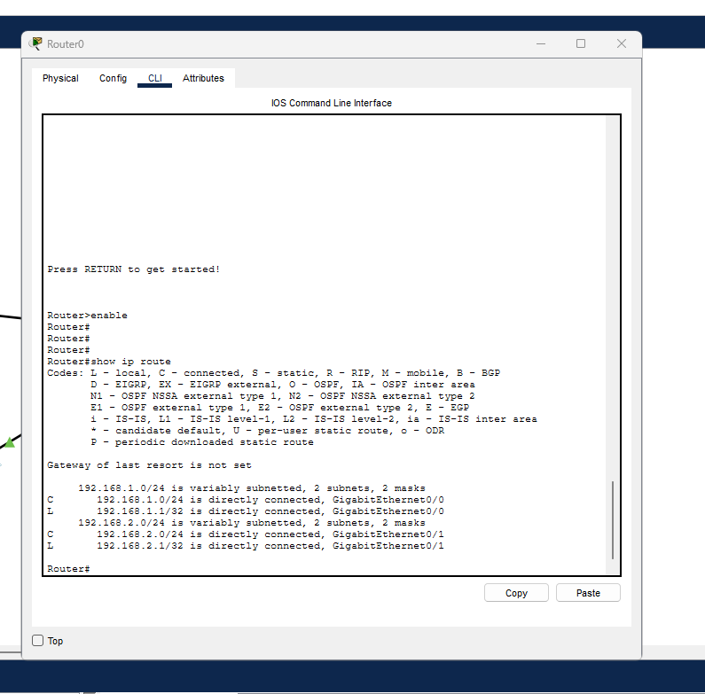
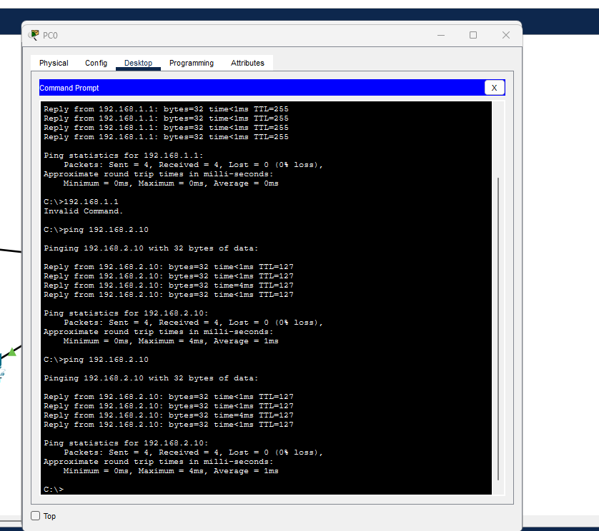
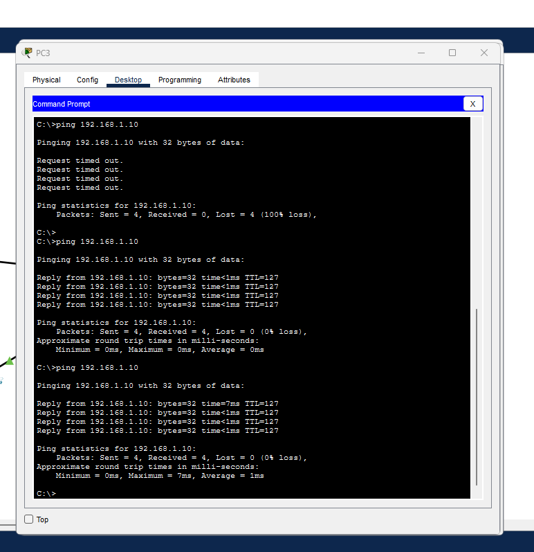

# Relier deux réseaux avec un routeur

Exercice Cisco Packet Tracer réalisé le 27 octobre 2026. Les captures montrent une communication réussie entre PC0 et PC3, dans les deux sens. Elles documentent le résultat de cette séance, sans prétendre à une maîtrise autonome.

## Topologie et adresses

Deux réseaux locaux sont reliés par Router0 :

| Appareil / interface | Adresse IPv4 | Masque | Passerelle |
|---|---|---|---|
| Router0 GigabitEthernet0/0 | 192.168.1.1 | 255.255.255.0 | — |
| PC0 | 192.168.1.10 | 255.255.255.0 | 192.168.1.1 |
| Router0 GigabitEthernet0/1 | 192.168.2.1 | 255.255.255.0 | — |
| PC3 | 192.168.2.10 | 255.255.255.0 | 192.168.2.1 |

Chaque interface du routeur est reliée au switch de son réseau. La passerelle d’un PC est l’adresse de l’interface du routeur présente dans son réseau local.

## Vérification du routeur

Dans le CLI, `show ip route` affiche les routes connues. La sortie observée contient les deux réseaux comme directement connectés : `192.168.1.0/24` sur GigabitEthernet0/0 et `192.168.2.0/24` sur GigabitEthernet0/1.

La mention « Gateway of last resort is not set » indique qu’aucune route par défaut vers un autre réseau, comme Internet, n’est configurée. Elle n’empêche pas la communication entre ces deux réseaux directement connectés.

## Tests de communication

Les commandes `ping` ont été lancées depuis les PC. Après un premier essai sans réponse, les tests suivants ont reçu quatre réponses sans perte dans chaque sens.

| Source | Destination | Envoyés | Reçus | Perdus |
|---|---|---:|---:|---:|
| PC0 — 192.168.1.10 | PC3 — 192.168.2.10 | 4 | 4 | 0 |
| PC3 — 192.168.2.10 | PC0 — 192.168.1.10 | 4 | 4 | 0 |

## Ce que l’exercice montre

- Un switch relie des appareils dans un même réseau local.
- Un routeur permet aux appareils de communiquer entre des réseaux IP différents.
- Pour envoyer un message vers l’autre réseau, chaque PC doit utiliser comme passerelle l’interface locale du routeur.
- `show ip route` permet de lire les réseaux connus du routeur ; `ping` vérifie si une destination répond.

Les autres postes éventuellement présents sur le schéma ne sont pas déclarés testés ici. Le fichier `.pkt` reste sur le PC de l’apprenant et n’est pas inclus dans ce dépôt.
