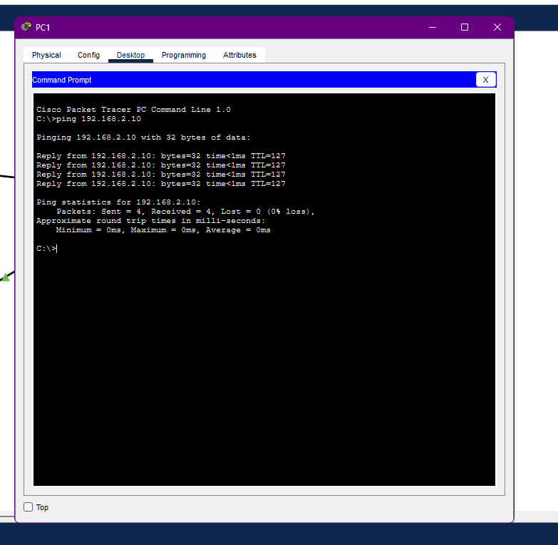
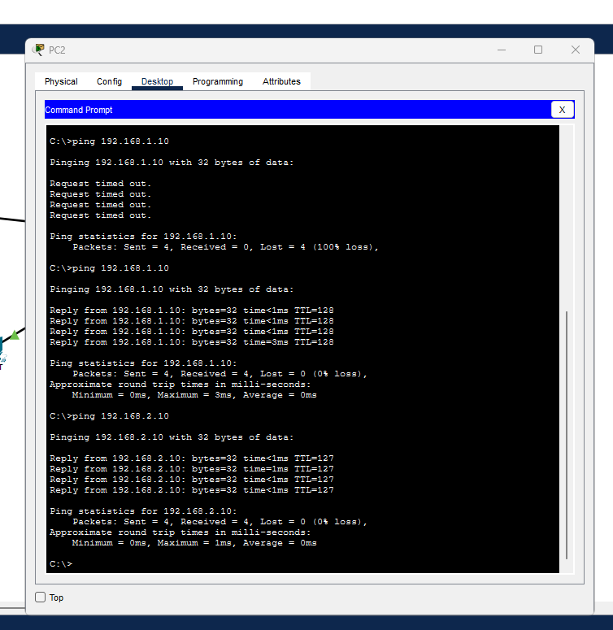

# Relier deux réseaux avec un routeur

Exercice Cisco Packet Tracer réalisé le 27 octobre 2026. Il met en pratique deux réseaux IPv4 reliés par Router0. Les tests de ping et la table de routage ont été observés pendant la séance. Les notions ci-dessous ont été comprises avec accompagnement ; elles seront consolidées par d'autres exercices.

## Topologie et adresses

```text
PC0 .1.10 ─┐                       ┌─ PC3 .2.10
PC1 .1.20 ─┼─ Switch0 ─ G0/0 Router0 G0/1 ─ Switch1
PC2 .1.30 ─┘      réseau 1         réseau 2
                   .1.0/24          .2.0/24
```

| Appareil / interface | Adresse IPv4 | Masque | Passerelle |
|---|---|---|---|
| Router0 G0/0 | 192.168.1.1 | 255.255.255.0 (/24) | — |
| PC0 | 192.168.1.10 | 255.255.255.0 (/24) | 192.168.1.1 |
| PC1 | 192.168.1.20 | 255.255.255.0 (/24) | 192.168.1.1 |
| PC2 | 192.168.1.30 | 255.255.255.0 (/24) | 192.168.1.1 |
| Router0 G0/1 | 192.168.2.1 | 255.255.255.0 (/24) | — |
| PC3 | 192.168.2.10 | 255.255.255.0 (/24) | 192.168.2.1 |

G0/0 est relié à Switch0 ; G0/1 est relié à Switch1. Ces noms désignent des ports du routeur. Le câble reste branché : selon le sens du trafic, un port reçoit le message et l'autre le transmet.

## Ce que montre la table de routage

La commande `show ip route` affiche les réseaux et adresses que le routeur connaît.

| Ligne observée | Interprétation dans ce lab |
|---|---|
| `C 192.168.1.0/24 ... G0/0` | Le réseau 192.168.1.0/24 est directement relié au routeur par G0/0. |
| `C 192.168.2.0/24 ... G0/1` | Le réseau 192.168.2.0/24 est directement relié au routeur par G0/1. |
| `L 192.168.1.1/32 ... G0/0` | Adresse exacte du routeur sur G0/0. |
| `L 192.168.2.1/32 ... G0/1` | Adresse exacte du routeur sur G0/1. |

`C` indique ici un réseau directement connecté. `L` indique une adresse IPv4 précise du routeur. `/24` décrit le réseau du lab ; `/32` désigne une adresse unique dans cette table. Les interfaces du routeur restent configurées avec le masque `/24`.

La mention `Gateway of last resort is not set` est attendue dans cet exercice : aucune route vers Internet n'a été configurée.


## Tests de communication

Chaque test ci-dessous a reçu quatre réponses sur quatre, sans perte :

| Source | Destination | Résultat |
|---|---|---|
| PC0 — 192.168.1.10 | PC3 — 192.168.2.10 | 4/4 réponses, 0 % de perte |
| PC3 — 192.168.2.10 | PC0 — 192.168.1.10 | 4/4 réponses, 0 % de perte |
| PC1 — 192.168.1.20 | PC3 — 192.168.2.10 | 4/4 réponses, 0 % de perte |
| PC2 — 192.168.1.30 | PC3 — 192.168.2.10 | 4/4 réponses, 0 % de perte |






## Repères compris pendant la séance

- Le switch relie les appareils du même réseau local. PC0 et PC2 peuvent communiquer par Switch0.
- Pour joindre un autre réseau, un PC envoie le trafic à la passerelle située dans son propre réseau : PC0 utilise `192.168.1.1` et PC3 utilise `192.168.2.1`.
- Le routeur relie les deux réseaux. De PC3 vers PC1, le trafic entre par G0/1 puis ressort par G0/0 ; dans l'autre sens, il entre par G0/0 et ressort par G0/1.
- `ping` vérifie qu'une adresse répond ; `show ip route` permet de consulter les réseaux connus du routeur.

Les concepts `C`, `L` et `/24` versus `/32` ont demandé des corrections et restent à pratiquer. Le fichier `.pkt` demeure sur le PC de l'apprenant et n'est pas inclus dans ce dépôt.
